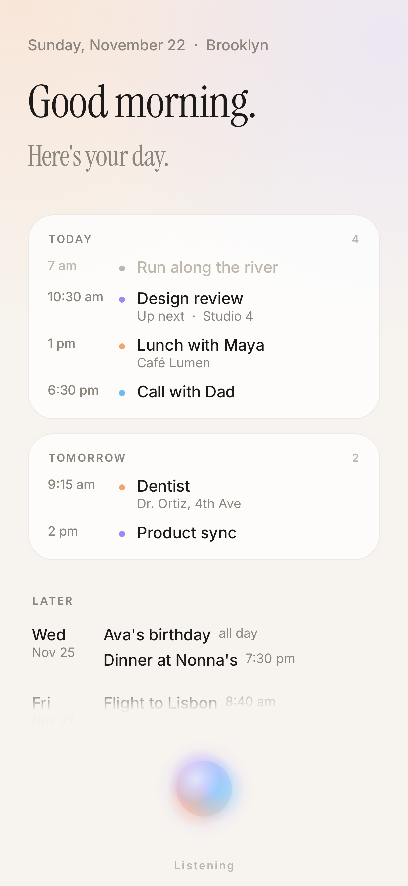

# 2brain

A minimalist, voice-only Android assistant. Open it, and it greets you, shows your day, and listens.



## What you can say

| Say | It does |
| --- | --- |
| "What's on tomorrow / Friday / this week?" | Reads your calendar |
| "Add lunch with Sam Friday at 12:30" / "Remind me to call mom at 6 pm" | Adds a calendar event |
| "Show my photos from yesterday" … "close" | Shows a photo grid |
| "Where am I?" / "Navigate to the airport" | Uses your location / opens Maps |
| "Set a timer for 10 minutes" / "Set an alarm for 7 am" | Clock app |
| "Call me Alex" | Personalises the greeting |
| "Go to sleep" … "2brain" | Pauses / resumes listening |
| "What can you do?" | Help |

## Build

Requires JDK 17+ and the Android SDK (API 35).

```bash
./gradlew :app:assembleDebug
```

The APK lands in `app/build/outputs/apk/debug/`.

## Tests and screenshots

```bash
./gradlew :app:testDebugUnitTest -Proborazzi.test.record=true
```

This runs the command-parser tests and re-renders the screens in `screenshots/` using sample data.

## Notes

- Android requires tapping its permission dialogs once on first launch; everything after that is voice.
- Listening runs while the app is open (not in the background).
- Commands are matched with rules (offline, fast); unusual phrasings may not be understood yet.
